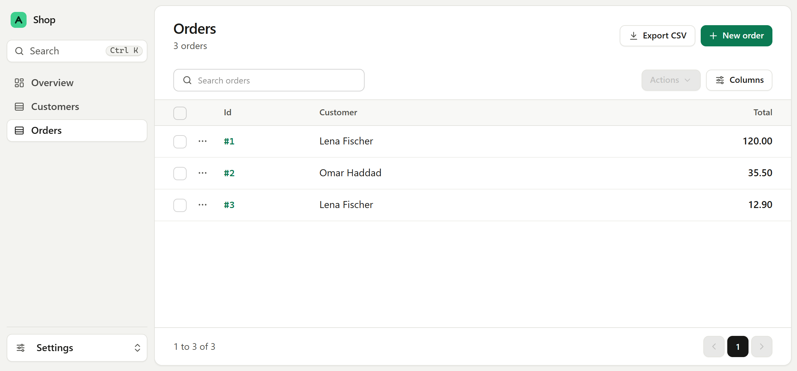

# Getting started

This page builds a working admin in one file, then shows how to add it to your own app.

## Install

```
pip install adminsite fastapi uvicorn aiosqlite
```

The example runs on SQLite through `aiosqlite`. For your own database, install its driver instead,
such as `asyncpg` or `psycopg` for Postgres.

## A first admin

Save this as `main.py`:

```python
from collections.abc import AsyncIterator
from contextlib import asynccontextmanager
from decimal import Decimal

from fastapi import FastAPI
from sqlalchemy import ForeignKey, Numeric, String
from sqlalchemy.ext.asyncio import AsyncSession, create_async_engine
from sqlalchemy.orm import DeclarativeBase, Mapped, mapped_column, relationship

from adminsite import Admin, Link, ModelView


class Base(DeclarativeBase):
    pass


class Customer(Base):
    __tablename__ = "customers"

    id: Mapped[int] = mapped_column(primary_key=True)
    name: Mapped[str] = mapped_column(String(120))
    email: Mapped[str] = mapped_column(String(255), unique=True)

    def __str__(self) -> str:
        return self.name


class Order(Base):
    __tablename__ = "orders"

    id: Mapped[int] = mapped_column(primary_key=True)
    customer_id: Mapped[int] = mapped_column(ForeignKey("customers.id"))
    total: Mapped[Decimal] = mapped_column(Numeric(10, 2))

    customer: Mapped[Customer] = relationship()


class CustomerView(ModelView[Customer]):
    fields = [Customer.name, Customer.email]
    searchable_fields = [Customer.name, Customer.email]


class OrderView(ModelView[Order]):
    fields = [Order.id, Order.customer, Order.total]
    searchable_fields = [Order.id, Link(Order.customer, Customer.name)]


engine = create_async_engine("sqlite+aiosqlite:///shop.db")


@asynccontextmanager
async def lifespan(app: FastAPI) -> AsyncIterator[None]:
    # Create the tables, and a few rows to look at the first time.
    async with engine.begin() as connection:
        await connection.run_sync(Base.metadata.create_all)
    async with AsyncSession(engine) as session:
        if await session.get(Customer, 1) is None:
            lena = Customer(name="Lena Fischer", email="lena@example.com")
            omar = Customer(name="Omar Haddad", email="omar@example.com")
            session.add_all(
                [
                    Order(customer=lena, total=Decimal("120.00")),
                    Order(customer=omar, total=Decimal("35.50")),
                    Order(customer=lena, total=Decimal("12.90")),
                ]
            )
            await session.commit()
    yield


app = FastAPI(lifespan=lifespan)
admin = Admin(engine, title="Shop", views=[CustomerView, OrderView])
app.mount("/admin", admin)
```

Run it:

```
uvicorn main:app --reload
```

Open http://127.0.0.1:8000/admin. Customers and Orders are in the sidebar. Each list can be
searched, sorted and paged, and each record has a page to read, change or delete it.



What the code does:

- `fields` lists what each page shows, in order.
- `Order.customer` is a relationship, so the list shows the customer's name and the form picks a
  customer from a list.
- `Link(Order.customer, Customer.name)` is a column of the related model. Here it lets the search
  box find orders by the customer's name.
- `lifespan` creates the tables and adds a few rows, so there is something to see.

## Use your own models

Pass your app's engine and a view for each model. A view with no settings shows every column, so
this is enough to start:

```python
admin = Admin(engine, views=[ModelView[Customer], ModelView[Order]])
app.mount("/admin", admin)
```

[Views](views.md) shows what else a view can say.

## Mount it in Starlette or Litestar

The admin is an ASGI app, so it mounts wherever ASGI apps do, at any path:

=== "FastAPI"

    ```python
    app.mount("/admin", admin)
    ```

=== "Starlette"

    ```python
    from starlette.applications import Starlette
    from starlette.routing import Mount

    app = Starlette(routes=[Mount("/admin", app=admin)])
    ```

=== "Litestar"

    ```python
    from litestar import Litestar, asgi
    from litestar.types import Receive, Scope, Send


    @asgi("/admin", is_mount=True, copy_scope=True)
    async def admin_app(scope: Scope, receive: Receive, send: Send) -> None:
        await admin(scope, receive, send)


    app = Litestar(route_handlers=[admin_app])
    ```

## Add a sign in

Anyone who can open the admin can change your data, so add a sign in before it goes online.
[Signing in](auth.md) shows how, with users and roles you manage in the admin or your own user
table. Read [Permissions](permissions.md) before other people use it.

## A bigger example

[The live demo](https://adminsite.duckdns.org) runs a shop with every feature switched on. Sign in
as admin with the password admin. Its code is
[examples/shop.py](https://github.com/nimaxin/adminsite/blob/main/examples/shop.py).
